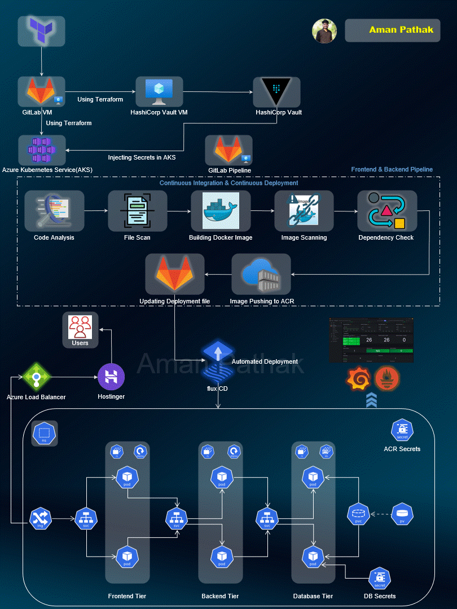

# Azure AKS GitOps platform

Portfolio lab maintained in [bckish/azure-aks-gitops-platform](https://github.com/bckish/azure-aks-gitops-platform). The implementation is derived from upstream work; this repository's documentation and validation changes do not imply an independently verified cloud deployment.

A three-tier React/Node/MongoDB learning platform with Azure Terraform roots, GitLab CI examples, Kubernetes manifests and Flux configuration.



## Repository map

- [Infra-Code-Terraform](Infra-Code-Terraform/): separate AKS, GitLab VM and Vault VM roots.
- [Source-Code-Build](Source-Code-Build/): frontend and backend, Dockerfiles, npm lockfiles and GitLab CI examples.
- [Kubernetes-Manifests](Kubernetes-Manifests/): workload and Flux manifests.

## Local validation (no Azure deployment)

```bash
git clone https://github.com/bckish/azure-aks-gitops-platform.git
cd azure-aks-gitops-platform
node --check Source-Code-Build/backend/index.js
for root in Infra-Code-Terraform/azure-*; do
  terraform -chdir="$root" init -backend=false && terraform -chdir="$root" validate || exit 1
done
```

Dependencies and Terraform providers require network access. For deployment, supply your own Azure subscription, storage backend, SSH public key, GitLab runners and masked variables, Vault roles, registry and image references. The Flux repository and credentials must point to your own GitOps repository with matching paths. The included GitLab files represent separate pipeline roots; review them before importing. Application pipelines use lockfile installs and block on image scan findings; registry publication is manual. Manifest updates should be proposed separately in your own GitOps repository, not pushed to an inherited repository. Do not execute their manual apply/destroy jobs against a shared environment. No Azure infrastructure is deployed by the local checks.

The AKS root no longer calls the deprecated Vault KV data source. Retrieve the service-principal values through your own approved Vault/secret-injection workflow, then provide masked `TF_VAR_aks_client_id` and `TF_VAR_aks_client_secret` environment variables to Terraform and GitLab. Never commit or log them. The AzureRM service-principal fields are not write-only, so sensitive plan and state storage must still be protected. The separate Vault VM lab remains intact.

See the original [architecture walkthrough](https://medium.com/@amanpathakdevops/advanced-end-to-end-devsecops-kubernetes-three-tier-project-using-azure-aks-fluxcd-prometheus-cca3c5e61953).

## Attribution and license

Original implementation by Aman Pathak. See [UPSTREAM.md](UPSTREAM.md) for the source repository and [LICENSE](LICENSE) (Apache-2.0). The upstream license and copyright notices are unchanged.
## Local application demo (no cloud or database required)

Use Node 22.12+ (or newer compatible Node). Run the backend with an explicit temporary in-memory store; task data is lost when the process exits. Set MONGO_CONN_STR instead of LOCAL_MEMORY for a real local MongoDB connection.

```bash
cd Source-Code-Build/backend
npm ci
npm test
LOCAL_MEMORY=true npm start
```

In a second terminal, from the repository root:

```bash
cd Source-Code-Build/frontend
npm ci
npm start
```

The UI defaults to http://127.0.0.1:3500/api/tasks in local mode. Set REACT_APP_BACKEND_URL when deploying it elsewhere. No cloud deployment is performed.

## Verified local Kubernetes and Flux results

Test date: 25 November 2026. Environment: Docker Desktop on Apple Silicon, Kind v0.30.0, Kubernetes v1.34.3. Local images were imported into the isolated cluster; no images were pushed to a registry and no paid cloud resources were created.

Tested code: `71b621d` (merged main). The actual frontend/backend Docker builds and MongoDB 7 were deployed into Kind using a local StatefulSet and dynamic storage. The frontend and API were ready, and real MongoDB task create/read/update/delete passed before and after GitOps reconciliation.

Flux v2.2.3 (source-controller v1.2.4 and kustomize-controller v1.2.2 from this repository) reconciled a disposable local Git repository. Both GitRepository and Kustomization reported **Ready=True**. Revision `dcc5f41` deployed one API replica; revision `2e8ab9e` updated a proof ConfigMap and scaled the API to two ready replicas. Flux restored two healthy replicas after manual scale drift to one.

Use the [local Kubernetes fixture](local-k8s/) with a disposable Kind cluster, not the inherited Azure/Flux source:

```bash
docker build -t bckish-local/azure-task-api:runtime Source-Code-Build/backend
docker build -t bckish-local/azure-task-ui:runtime Source-Code-Build/frontend
docker pull mongo:7
kind load docker-image --name YOUR_LOCAL_KIND bckish-local/azure-task-api:runtime bckish-local/azure-task-ui:runtime mongo:7
kubectl --kubeconfig /path/to/local-kind.kubeconfig create namespace flux-task
kubectl --kubeconfig /path/to/local-kind.kubeconfig apply -k local-k8s
```

If needed on ARM64, export the platform-specific image archive with `docker image save --platform linux/arm64` and load it using `kind load image-archive`. Forward local API/UI ports 23501/23301. The successful local reconciliation does not establish live AKS, ACR, Vault, GitLab or Azure ingress operation.

## Dependency maintenance (26 November 2026)

Migrated the API to Mongoose 8.24.11, replaced deprecated Material UI v4 controls with native React form controls, and refreshed compatible backend transitive dependencies. Clean npm installs, production build, strict Node API tests, and Terraform validation passed. Rebuilt Docker images passed authenticated MongoDB 7 CRUD and browser tests without browser errors or deprecation warnings. CI now rejects Node deprecation warnings during API tests. No Azure resources were created.

The rebuilt images also passed MongoDB-backed CRUD in local Kind. Flux v2.2.3 reconciled revisions `ba89310` and `08232e4`, restored two ready API replicas after deliberate drift, and both GitRepository and Kustomization returned Ready=True.
